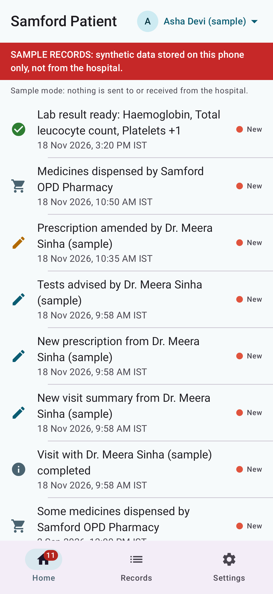
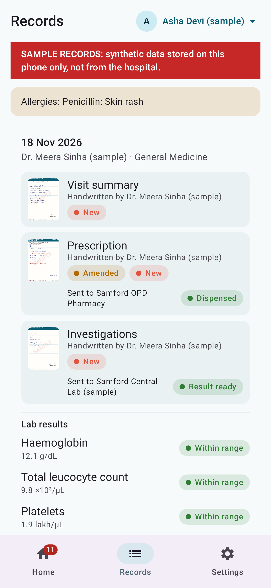
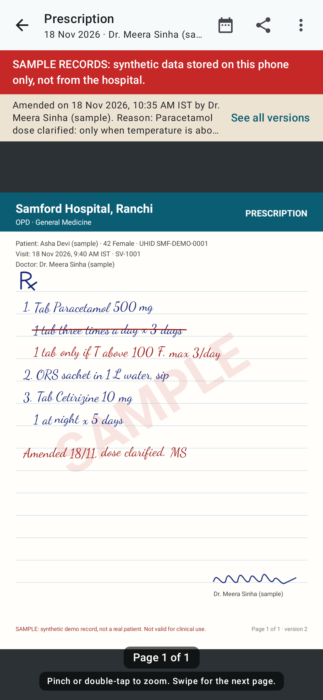
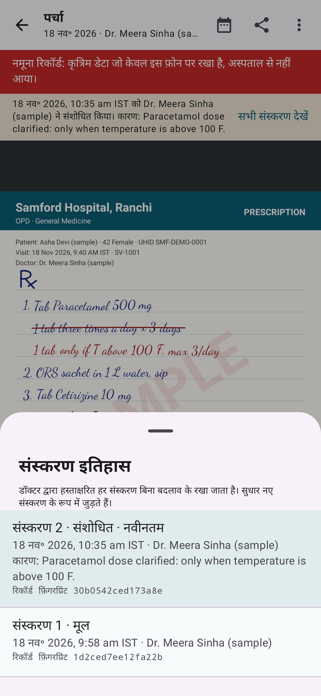
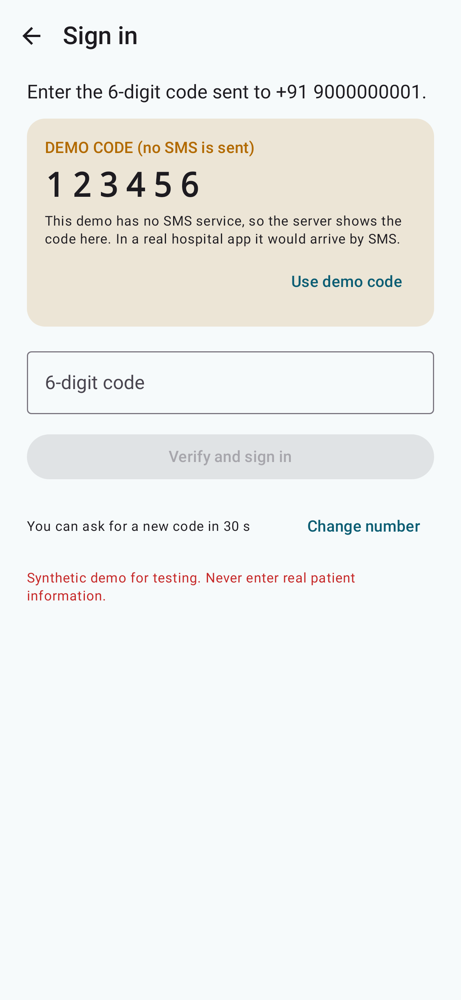
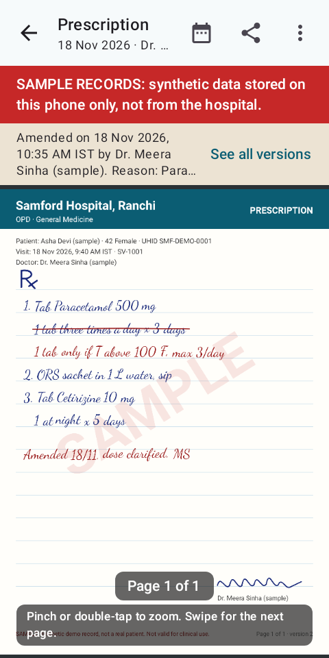
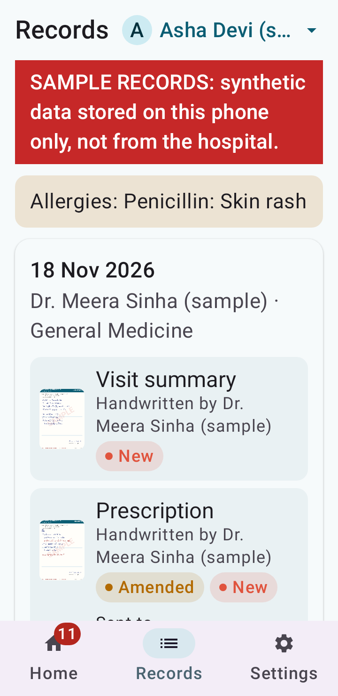
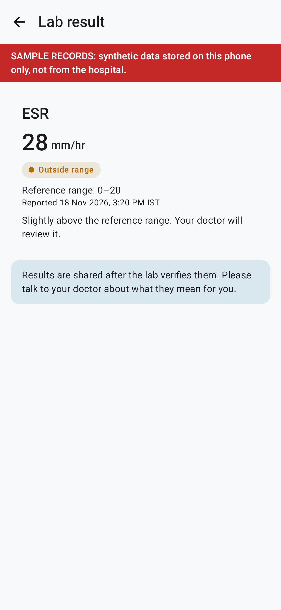
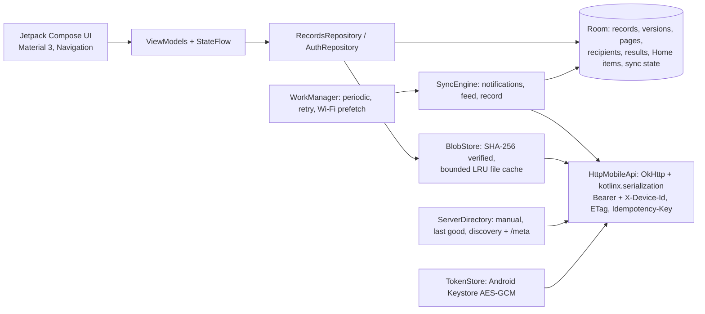

# Samford Patient (Android)

Companion app for patients in the **paperless OPD** of Samford Hospital, Ranchi. The doctor writes
on a Samsung tablet ([samford-doctor-android](https://github.com/shivam098/samford-doctor-android));
when the visit is marked completed, the handwritten visit summary, prescription and investigations
are synced. The pharmacy and labs receive the same pages, and this app shows the patient **exactly
the same handwriting**, page for page and byte for byte, with dispensing and lab status, so nothing
has to be printed, carried or kept.

> **Synthetic demo.** There is no real backend, SMS, push or patient data. The shared mock hospital
> is [samford-web-app](https://github.com/shivam098/samford-web-app). Never enter real patient
> information.

| Home | Records | Handwritten prescription (amended) | Version history (Hindi) |
|---|---|---|---|
|  |  |  |  |

| Demo code sign-in | Small phone (320 dp) | Large text (1.5×) | Lab result |
|---|---|---|---|
|  |  |  |  |

All screenshots are in [docs/screenshots](docs/screenshots) (phone and small phone, English and
Hindi, large text). Robolectric + Roborazzi tests generate them; they were reviewed by eye.

## Install the test APK

1. Download `samford-patient-v0.1.0.apk` and `samford-patient-v0.1.0.apk.sha256` from the
   [v0.1.0 release](https://github.com/shivam098/samford-patient-android/releases/tag/v0.1.0).
2. Recommended: check the file. Windows: `certutil -hashfile samford-patient-v0.1.0.apk SHA256`;
   Linux/macOS: `sha256sum samford-patient-v0.1.0.apk`. It must match the `.sha256` file.
3. On the phone (Android 8.0 or newer), open the APK and allow "Install unknown apps" for your
   browser or Files app when asked.
4. Open **Samford Patient**. Either sign in (needs the demo server online) or tap
   **Explore sample records (offline)**.

## Try it

**With the demo server:** tap *Sign in with mobile number*, pick a demo number and tap *Send code*.
There is no SMS provider, so the server returns the code and the app shows it in a box clearly
labelled **DEMO CODE**. Tap *Use demo code*, then *Verify and sign in*.

| Demo mobile | What you will see |
|---|---|
| `9000000001` | Demo patient A and Demo child A (switch between them from the name at the top): an earlier handwritten visit with a visit summary, a dispensed prescription, investigations and a released Haemoglobin result |
| `9000000002` | Demo patient B: an earlier handwritten visit (summary, dispensed prescription, investigations with a fasting glucose result) that has not been opened yet |
| `9000000003` | Demo patient C |

Amendments: the offline sample records include a prescription amended to version 2, with the
original still viewable from version history.

The server's limits apply: one code per 30 s, 3 per 10 minutes; three wrong codes lock that mobile
for 30 minutes. The app explains each case in plain English or Hindi.

**Without a server:** *Explore sample records (offline)* creates synthetic records on the phone (two
family members, three visits, an amended prescription, lab results, pharmacy and lab status). Every
screen and page says SAMPLE. *Settings → Leave sample mode* removes them.

## Server discovery and override

The app finds the hospital server in this order:

1. an address you entered (Settings → Server settings), which is never replaced silently;
2. the last server that answered;
3. the discovery document built into the app:
   `https://gist.githubusercontent.com/shivam098/a4237b7aa37de0c876d5c08a3c250d52/raw/samford-endpoint.json`
   (`apiBaseUrl` changes when the demo tunnel restarts; `status` can be `offline`).

Each candidate is checked with `GET {apiBaseUrl}/meta` first. In Settings → Server settings you can
type an address, **scan a server QR code**, open a `samfordpatient://connect?api=<url>` link with the
phone camera (it opens the screen pre-filled for you to confirm), or change the discovery page.
Release builds require HTTPS, except `localhost`, `127.0.0.1` and the emulator's `10.0.2.2` for
local testing.

To test against your own isolated backend:

```powershell
git clone https://github.com/shivam098/samford-web-app.git; cd samford-web-app
git checkout 83be4ae; npm ci
npm run mobile:isolated -- --port 4321 --data "$env:TEMP\samford-4321" --reset --relaxed-limits --test-support
```

In an emulator, enter `http://10.0.2.2:4321/api/mobile/v1` as the server address.

## Features

- Mobile + OTP sign-in with a visible demo code, a device-bound token, plain-language errors and
  rate-limit messages. A different mobile signing in on the same phone first wipes the previous
  person's records.
- Family profiles linked to the same mobile, with a profile switcher on Home and Records.
- **Home**, newest first: "New prescription from Dr …", "Prescription amended by …", "Lab result
  ready: …", "Medicines dispensed by …", "Token 12 called".
- **Records** timeline by visit: handwritten visit summary, prescription, investigations and
  advice/referral with thumbnails; **who received each document** (pharmacy, each lab) and its state
  (dispensed, sample collected, result ready); lab results with reference range and flag; allergies.
- **Document viewer**: the doctor's exact page images, smooth pinch and double-tap zoom with
  sub-sampling for high-resolution pages, swipe between pages, an **Amended** banner with the
  reason, full **version history** (the original stays viewable), typed hints shown as an unverified
  summary for screen readers, the record fingerprint, and **share or save a PDF** with a SAMPLE band.
  Each page is checked against its SHA-256 before it is shown.
- **Notifications** without FCM: WorkManager every 30 minutes plus a 60-second probe while the app is
  open, posted as local notifications with generic text only ("You have 2 new updates"). Settings
  says so plainly.
- **Offline:** everything already synced stays readable, Home shows when the data was last updated
  (IST), and sync resumes automatically.
- **Settings:** English / हिन्दी, server discovery and override with QR, notification and Wi-Fi
  download switches, storage used and a clear button, an optional PIN app lock, and sign out (removes
  every cached record and file).

## Architecture



| Area | Choice | Why |
|---|---|---|
| Language/UI | Kotlin 2.4, Jetpack Compose (BOM 2026.09), Material 3 | Android-native, small, fast to iterate |
| Build | AGP 9.5.2 (built-in Kotlin), Gradle 9.9.2, KSP, R8 + resource shrinking | ~2.3 MB release APK |
| Storage | Room 2.8, DataStore, files in `noBackupFilesDir` | transactional sync; no cloud backup of health data |
| Network | OkHttp 5, kotlinx.serialization | small; tolerant decoding (unknown fields ignored) |
| Images | Coil 3 + Telephoto zoomable image | sub-sampled deep zoom without huge bitmaps |
| Background | WorkManager | Doze-friendly, constraints, survives reboots |
| Security | Android Keystore AES-256-GCM token, PBKDF2 PIN hash | tokens never stored in clear |
| DI | a small hand-written `AppContainer` | no annotation-processing DI; faster cold start |
| Startup | Baseline Profiles (generator module + library profiles), profileinstaller | faster first launch |
| minSdk | **26 (Android 8.0)** | covers almost all active low-end Indian phones; native `java.time`, notification channels and adaptive icons without desugaring |
| target/compileSdk | 37 (Android 17) | |

Details: [sync and caching design](docs/sync-and-caching.md), [client load model](docs/client-load-model.md),
[validation report](docs/validation-report.md).

## Scale (1 lakh patients)

In steady state each phone costs the server **one conditional request every 30 minutes** (a 304 with
no body), spread across the window by a stable per-install random phase. Feed and record requests
happen only for profiles that actually changed, and pages download once and are never revalidated.
Failures back off exponentially with jitter and honour `Retry-After`. At 1 lakh users that is about
5 million requests a day (~60/s on average), over 95 % of them 304s. The
[client load model](docs/client-load-model.md) is a client model, not a production capacity claim
for the single-node mock.

## Build and test

Requirements: JDK 21, Android SDK with platform 37, and `ANDROID_HOME` set (or `local.properties`).

```powershell
.\gradlew :app:assembleDebug                      # debug APK
.\gradlew :app:lintDebug :app:testDebugUnitTest   # lint, unit and Robolectric UI tests
.\gradlew :app:recordRoborazziDebug               # regenerate docs/screenshots
# Real backend integration tests (backend running on port 4321):
.\gradlew :app:testDebugUnitTest --tests "com.samford.patient.integration.BackendIntegrationTest" "-Psamford.itBase=http://127.0.0.1:4321"
# Cross-app E2E: the doctor app writes a handoff file, then this app verifies it
.\gradlew :app:testDebugUnitTest --tests "com.samford.patient.integration.CrossAppPatientVerifyTest" "-Psamford.e2eIn=<handoff.json>"
# Emulator or device tests, optionally against the backend on the host:
.\gradlew :app:connectedDebugAndroidTest "-Pandroid.testInstrumentationRunnerArguments.itBase=http://10.0.2.2:4321"
# Signed release (maintainer only; the keystore and its DPAPI-protected password live outside the repo):
.\scripts\Build-SignedRelease.ps1
```

CI ([.github/workflows/android.yml](.github/workflows/android.yml)) runs lint, unit and UI tests,
debug and unsigned release builds and screenshots; backend integration and the cross-app E2E with the
real doctor app against the pinned mock backend; and instrumented tests on an API 34 emulator with
device screenshots and Baseline Profile generation.

## Project decisions (made by the coordinator while the user was unavailable)

1. Both app repositories are public, like the web app, so APKs can be shared from GitHub Releases.
   No secrets, keystores, tokens or real data are committed.
2. The shared mock backend is the Samford web app; its session owns the mobile API contract.
3. The doctor tablet app is a separate repository and renders the canonical page images and PDF.
4. Scope is the patient side of the paperless OPD journey, not a full patient portal (no booking or
   payments).

## Limitations

- Synthetic demo: no real SMS, push (FCM), ABHA/ABDM, payments or clinical signing. OTP codes are
  shown on screen on purpose.
- Notifications are polled, so they can arrive up to ~30 minutes late (longer under Doze).
- The share PDF is assembled on the phone from the verified page images with a SAMPLE band; the
  hospital's own PDF is used only for versions without page images.
- Handwritten text is never translated; Hindi covers the app's own text.
- The PIN app lock is a convenience lock, not a substitute for the phone's screen lock.
- Scale figures are a client load model plus mock-server measurements, not a production load test.
- [docs/validation-report.md](docs/validation-report.md) lists exactly what was and was not verified.
