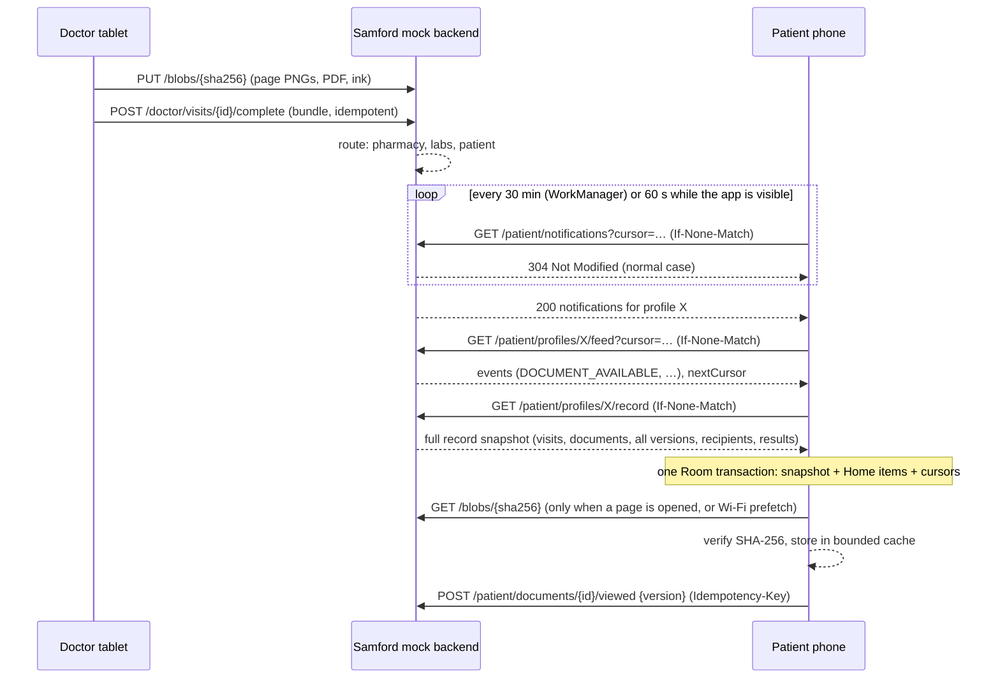

# Sync, caching and offline design

This is how the Samford Patient app keeps a family's OPD records on the phone, keeps them current
without push notifications, and stays cheap for the server at 1 lakh users. The API contract is
owned by the backend: `docs/mobile-api-v1.yaml` and `docs/mobile-sync.md` in
[shivam098/samford-web-app](https://github.com/shivam098/samford-web-app) (v1.0.0; built against M2 commit
`83be4ae`, re-verified at `dffde17`).

## Data flow

## Sync engine (`core/sync/SyncEngine.kt`)

| Step | Request | When | Normal result |
|---|---|---|---|
| Profiles | `GET /patient/profiles` (If-None-Match) | at most daily, or when a notification names an unknown profile | 304 |
| Probe | `GET /patient/notifications?cursor` (If-None-Match) | every periodic or foreground run | 304 |
| Events | `GET /patient/profiles/{id}/feed?cursor` (If-None-Match once caught up) | only for profiles named in new notifications, the first sync, or pull-to-refresh | 304 / few events |
| Record | `GET /patient/profiles/{id}/record` (If-None-Match) | only after new events, after a failed record fetch, or on pull-to-refresh | 200 after a change |
| Pages | `GET /blobs/{sha256}` with bearer | when a page is opened; Wi-Fi prefetch of recent current versions | 200 once, then never again |
| Viewed | `POST /patient/documents/{id}/viewed` | after a page of the latest version is shown for 1 s | 200 (idempotent) |

- **Events are hints, the record is the truth.** Feed events produce the localised Home items
  ("New prescription from Dr …", "Medicines dispensed by …"); the record snapshot replaces the
  profile's local copy. Unknown event types and states are ignored or shown verbatim.
- **Atomic apply.** The record snapshot, the new Home items and both cursors are written in one Room
  transaction. A crash can never leave records and cursor out of step.
- **Quiet backfill.** The first sync of a profile (no cursor yet) creates Home items already marked
  as notified, so signing in never produces a notification storm.
- **Failed record fetch.** The feed cursor still advances, but the record scope is marked "needed",
  so the next run fetches the record even if no new events arrive.
- **Isolation.** Records whose `patientId` differs from the profile being synced are ignored, so a
  response can never mix family members or other families.
- **Pull-to-refresh** revalidates every profile (normally one 304 each) but is throttled to once per
  minute per profile and never overrides a server `Retry-After`.

## Backoff (`BackoffPolicy`)

- Equal jitter: the n-th consecutive failure waits a random time in `[d/2, d]`, `d = 30 s × 2^(n-1)`,
  capped at 6 hours. Thousands of phones that failed together come back spread out.
- `Retry-After` (seconds or HTTP date) is a floor, plus up to 10 % (max 60 s) extra spread.
- State is per scope (`notifications`, `profiles`, `feed:{id}`, `record:{id}`), persisted in Room, so
  backoff survives process death. A failed periodic run schedules a one-time WorkManager retry at
  the computed time.
- 401 `TOKEN_EXPIRED`/`TOKEN_INVALID`/`AUTH_REQUIRED`/`DEVICE_MISMATCH`: records stay readable and
  the app asks the person to sign in again. 401 `ACCESS_REVOKED`/`DEVICE_SIGNED_OUT`: the hospital
  ended this device's access, so records are wiped. 426 `APP_UPDATE_REQUIRED`: "please update".

## Scheduling (`SyncScheduler`, `SamfordApp`)

- Background: `PeriodicWorkRequest` every **30 minutes with a 10-minute flex window**, only on a
  connected network and when the battery is not low. Its initial delay is a **stable per-install
  random phase** (hash of the install ID modulo the period), so 1 lakh phones are spread across the
  whole window instead of firing on the hour. Doze and App Standby stretch it further.
- Foreground: while the app is visible, the notification probe runs every **60 seconds** (the
  contract's suggestion); it stops when the app goes to the background.
- Push (FCM) is out of scope. Local notifications are posted only for background runs and say only
  "You have N new updates. Open the app to view them." — never names, doctors, tests or medicines,
  on the lock screen or anywhere else.

## Page images and the bounded cache (`core/blob/BlobStore.kt`)

- Pages, PDFs and lab reports are content-addressed by SHA-256. The app always uses
  `GET /blobs/{sha256}` with the bearer token (never the 15-minute signed URLs), so cache keys never
  expire and a cached 304 record body with stale signed URLs is harmless.
- Every download is hashed while streaming and **rejected if the hash differs**; nothing unverified
  is ever shown. Because blobs are immutable, a cached page is never revalidated (zero requests on
  reopen).
- The cache lives in `noBackupFilesDir` (no cloud backup, no device transfer) with a Room index.
  Default limit 200 MB; above it, least-recently-used unpinned files are evicted down to 90 %.
  Offline sample pages are pinned. "Remove downloaded pages" clears re-downloadable files.
- Concurrent requests for one page share one download.
- **Lazy loading:** the record list never downloads pages; thumbnails appear only for pages already
  cached. A page downloads when opened. On unmetered networks (and battery not low) a one-time
  prefetch job downloads current-version pages of documents from the last 90 days, at most 40 MB per
  run and never more than half the cache, so recently synced records open offline.
- **Viewer:** Telephoto `ZoomableAsyncImage` with Coil 3 uses sub-sampling (`BitmapRegionDecoder`)
  for large pages, so a 1654×2339 page never needs a full-resolution bitmap in memory on low-end
  phones. Pinch, double-tap zoom and pan; pages swipe in a `HorizontalPager` that only takes the
  gesture when not zoomed.

## Offline

- Everything already synced is readable with no network: records, Home, version history, and any
  page already downloaded or prefetched.
- Home shows "Updated …" or "Offline. Showing records saved on this phone, last updated …" (IST).
- When the server is unreachable, testers can choose **Explore sample records (offline)**: synthetic
  records rendered on the phone, labelled SAMPLE everywhere, which go through the same record
  applier and event mapper as server data.

## Security and privacy on the phone

- The bearer token is encrypted with AES-256-GCM using a non-exportable Android Keystore key; only
  ciphertext is stored (DataStore). The app sends no cookies.
- `allowBackup=false` and data-extraction rules exclude all app data from cloud backup and device
  transfer.
- Sign-out (and "Forgot PIN") calls `DELETE /session` (best effort, 3 s), then removes the database,
  every cached page and exported PDF, pending acknowledgements, scheduled work, notifications, the
  token and account settings. Server address and language are kept. A different mobile signing in
  on the same phone triggers the same wipe first.
- Optional app lock: 4–6 digit PIN stored only as a salted PBKDF2-HMAC-SHA256 hash; locks on launch
  and after 30 s in the background; five wrong PINs pause entry with a growing wait.
- Release builds allow cleartext HTTP only to `localhost`, `127.0.0.1` and `10.0.2.2` (emulator
  host) for local testing; every other server must be HTTPS.

## Server discovery

Order: a manual override (never silently replaced) → the last server that answered → the discovery
document baked into the APK
(`https://gist.githubusercontent.com/shivam098/a4237b7aa37de0c876d5c08a3c250d52/raw/samford-endpoint.json`).
Every candidate is validated with `GET {apiBaseUrl}/meta` before use, because raw gist content is
cached for minutes. `status: offline|maintenance` and the operator message are shown; a
`minPatientAppVersion` above this app's versionCode shows "Update needed".

QR codes and links accepted in Settings → Server settings, or with the phone camera:
`samfordpatient://connect?api=<url>` or `?discovery=<url>`, a JSON object with `apiBaseUrl`, a
discovery URL ending in `.json`, or a plain server address. A scanned link only pre-fills the address;
the person confirms it.
